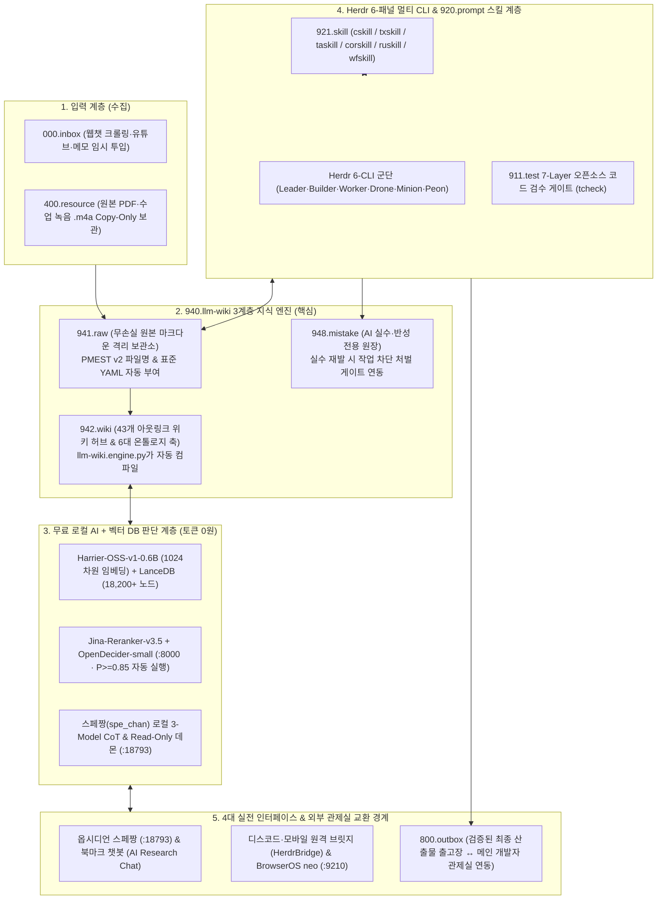

# Obsidian Autonomous LLM-Wiki · PMEST v2 · 46-Module Code Harness & Baseline System Architecture

> **[🏛️ Repository Overview | 아키텍처 설계도 및 전체 기본 시스템 구성 명세]**
> 수백 번의 시행착오와 `740+`건의 AI 실수 원장(`948.mistake`)을 바탕으로 구축하여 **매일 24시간 실전 가동 중인 '옵시디언(Obsidian) 기반 자율형 LLM-Wiki & 멀티 에이전트 코드 하네스 생태계'**의 전체 폴더 구조·명명 헌법·로컬 AI 스택·상시 기본 시스템 구성을 공개한 오픈소스 블루프린트입니다.
> - **비개발자·기획자**는 각 섹션의 **아키텍처 다이어그램과 요약 표**만으로 전체 작동 원리를 즉시 파악할 수 있습니다.
> - **엔지니어·시스템 아키텍트**는 본 저장소의 폴더 골격(`000.inbox`~`950.UI`), 지연 로딩 헌법(`AGENTS.md`), 상세 문서(`docs/01`~`03`)를 그대로 클론하여 **기존 프로덕션 서버·관제 시스템과 포트·코드 충돌(`0%`) 없이 독립된 자율형 지식 볼트**를 구축할 수 있습니다.

> **[📚 Deep-Dive Documentation Index | 심층 레퍼런스 문서 바로가기]**
> - **[`docs/01-baseline-system-configuration.md`](docs/01-baseline-system-configuration.md)** — **상시 유지 전체 기본 시스템 구성 백과사전** (`913.shell` 무창 데몬 & `24`개 스케줄러 XML · 로컬 AI `10`종 & `LanceDB` · `Herdr` 6-탭 & `OpenDecider` 4-Stage · **`46`개 코드 하네스 전수 카탈로그** · **`.obsidian` `79`개 플러그인 전수 카탈로그** · 3중 동기화 & 이중 암호화 보안 금고)
> - **[`docs/02-directory-tree-and-domain-catalog.md`](docs/02-directory-tree-and-domain-catalog.md)** — **`000.inbox` ~ `950.UI` 전 도메인 폴더·리프 카탈로그** (`110.science` 46개 정규 학문 리프 · `140.nonacademic` 4분류 · `410`↔`801` 대칭 구조 · `912.vein` · `921.skill` · `942.wiki` 43개 허브 & 6대 온톨로지)
> - **[`docs/03-python-automation-and-7layer-gate.md`](docs/03-python-automation-and-7layer-gate.md)** — **`532`개 Python 자동화 도구(`100`개 도메인 전수 집계) · `VaultCli` 18종 치트시트 · `911.test` 7-Layer 코드 승격 게이트(`tcheck` & `.ruff.toml`)**
> - **[`docs/04-pmest-v2-naming-and-bootstrap-guide.md`](docs/04-pmest-v2-naming-and-bootstrap-guide.md)** — **PMEST v2 + UDC 단일 기호 명명법 · 10자리 불변 `file_id` · 원자적 리네임 & 8대상 연쇄 최신화 · 4단계 부트스트랩 가이드**
> - **[`AGENTS.md`](AGENTS.md) / [`CLAUDE.md`](CLAUDE.md) / [`GEMINI.md`](GEMINI.md) & L1 `AGENTS.md`** — 클론 즉시 동작하는 **전역 헌법 + 도메인별 지연 로딩(`Lazy Load Map`) 스타터 템플릿**

---

## 1. 시스템 전체 작동 구조 (한눈에 보는 아키텍처)



---

## 2. 전체 볼트(Vault) 오픈소스형 디렉토리 트리 & 폴더별 기능·핵심 도구 백과사전 (`000` ~ `950`)

> **[핵심 설계 철학 (Open-Source LLM-Wiki Standard)]**
> 1. **3자리 숫자 프리픽스(`000`~`950`) 고정**: 모든 폴더 이름 앞에 3자리 번호를 부여해 정렬 순서를 영구 고정하고, 각 폴더에 **단 하나의 명확한 책임(Single Responsibility)**만 부여합니다.
> 2. **표면(Surface) 뷰와 원본(Raw) 데이터의 물리적 분리**: 사용자가 눈으로 보는 `000`~`400` 표면 폴더에는 **폴더 노트(`{folder}.md`), 자동 맵(`,.map.*`), 데이터베이스 뷰(`,.base.*`), `AGENTS.md`만** 남기고, 실제 일반 마크다운(`.md`) 문서는 상시 데몬(`raw-guard.py`)이 **`900.maintenance/940.llm-wiki/941.raw/<원래경로>/`**로 100% 자동 이관·동기화합니다.
> 3. **폴더별 `AGENTS.md` 지연 로딩(Lazy Load Map)**: 루트 `AGENTS.md`에는 핵심 프로토콜만 두고, 세부 폴더 규칙은 각 도메인의 L1 `AGENTS.md`에만 배치하여 AI가 작업할 때 토큰 폭탄 없이 필요한 폴더 규칙만 읽도록 설계했습니다.

### 2.1. 전체 볼트 마스터 디렉토리 트리 (GitHub 오픈소스 README 규격)

```text
space/ (<VAULT_ROOT> — 533+ Folders [실측 562개], 17,738+ MD Notes, 18,200+ Indexed Wiki/Skill Nodes, 531+ Python Scripts, 46 Code-Harness, 79 Plugins)
├─ AGENTS.md / CLAUDE.md / GEMINI.md        ← [전역 헌법] 멀티 CLI 공통 프로토콜 및 L1 폴더 Load Map 라우터 ("규칙 갱생" 핵심)
├─ .agents/                                 ← [CLI 플러그인·스킬 미러 허브] (,.py.sync.cli.py가 921.skill SSOT로부터 자동 동기화)
│  ├─ AGENTS.md                             ← .agents 전용 CLI 스킬 로딩 규칙
│  ├─ agents/                               ← 서브에이전트 정의 (leader, builder, worker, cli, search, grep, audit 등)
│  ├─ plugins/decider-fork-harness/         ← 4-Stage OpenDecider Fork Layer (sharp P>=0.85 코드직행 vs split 세션분기)
│  └─ skills/                               ← 11대 CLI 네이티브 스킬 (agent-desktop, browseros-neo, test-code-inspector 등)
├─ .cursor/ & .gemini/                      ← [IDE·CLI 규칙·훅 미러] (.cursor/rules/*.mdc, intent-constraint-gate 훅, CLI 설정 미러)
├─ .obsidian/                               ← [옵시디언 코어 & 79개 플러그인] (llm-wiki-chat, maintenance-filter 등 자체 제작 플러그인 포함)
│
├─ 000.inbox/                               ← [임시 수집함] 웹챗 크롤링·메모 임시 유입 (즉시 분류 후 비움 · 000.inbox/AGENTS.md)
│
├─ 100.vault/                               ← [지식 도서관 본관] 학문(110)·인문(120)·비학문(140)·직업/실무(150) (100.vault/AGENTS.md)
│  ├─ 110.science/                          ← PMEST v2 46개 정규 학문 리프(Leaf) 체계 (영문 약어 알파벳순 고정)
│  │  ├─ 111.natural-science/               ← 자연과학 5개 리프 (111-001.astro 천문 ~ 111-005.phys 물리)
│  │  ├─ 112.formal-science/                ← 형식과학 9개 리프 (112-001.cs 컴퓨터공학 ~ 112-009.syst 시스템과학)
│  │  ├─ 113.applied-science/               ← 응용과학 13개 리프 (113-001.actuar 보험수리 ~ 113-013.mil 군사학)
│  │  └─ 114.social-science/                ← 사회과학 19개 리프 (114-001.anthro 인류학 ~ 114-019.socwk 사회복지학)
│  ├─ 120.humanity/                         ← 인문학 (121.arts 예술·문화 / 122.thought 철학·사상)
│  ├─ 130.protoscience/ & 140.nonacademic/  ← 원형과학 및 비학문 4분류 (141.병리과학·142.정크사이언스·143.유사과학·144.반과학)
│  ├─ 150.occupation/                       ← 직업·실무·전문 기술 (반드시 4대 하위 폴더로만 분류, bare 150 지정 금지)
│  │  ├─ 151.specialized/                   ← 전문 기술 (151-001.stock 모의투자 원장, 151-002.cli, 151-003.fintech,
│  │  │                                        151-004.mnemonic 기억술, 151-005.kdata-cert 자격증, 151-006.obsidian)
│  │  ├─ 152.work/                          ← 실무·업무 산출물 및 152-000.university 대학 전공 강의 지식 정본
│  │  ├─ 153.hobby/                         ← 취미·여가 지식 노트
│  │  └─ 154.friends/                       ← 지인·인물 프로파일 및 코칭 기록
│  └─ 160.calendar/                         ← 연간·학기 캘린더 마스터
│
├─ 200.plan/                                ← [루틴·작업지·타임라인] (200.plan/AGENTS.md)
│  ├─ 210.routine/                          ← 자동화 루틴 (211.rest/211-001.youtube & 211-002.chzzk 추천봇, 212.chore, 213.health)
│  ├─ 220.tasks/                            ← 작업 관리 (221.workpaper 과목별/작업별 실시간 임시 작업장, 222.output)
│  └─ 230.timeline/                         ← 일일 피드백(daily-feedback) 및 시계열 타임라인 기록
│
├─ 300.areas/                               ← [개인 삶·창작물·일상 공간] (300.areas/AGENTS.md)
│  ├─ 310.force/                            ← 핵심 프로젝트 영역 (311.fiction 소설·Orion's Arm·Novel-OS, 313.c-store, 314.university)
│  └─ 320.spaces/                           ← 일상·서브컬처·실천 공간 (321.anime-manga, 322.vtuber, 323.game[323-001~007],
│                                              324.webcast, 325.vocal 보컬연습, 326.fashion 패션)
│
├─ 400.resource/                            ← [비마크다운 원본 아카이브 (Read-Only)] (400.resource/AGENTS.md)
│  ├─ 410.task-file/410-100.university/     ← 대학 수업 원본 자료 (_inbox Copy-Only, .extracted NLM STT, 410-101.pdf ~ 410-127.stl)
│  ├─ 420.source/                           ← 외부 유입 원본 소스 7대 정규 리프 폴더 (CANONICAL_420_DIRECT_SUBFOLDERS)
│  │  ├─ 420-001.novel/                     ← 소설·장문 텍스트 원문
│  │  ├─ 420-002.kakao-chats/               ← 카카오톡 대화 내보내기 원문
│  │  ├─ 420-003.game-file/                 ← 게임 모드·패치 설치 원본 아카이브 (install_manifest.json 포함)
│  │  ├─ 420-004.vocal/                     ← 보컬 가창 녹음(.m4a) 아티스트/곡별 정본 아카이브
│  │  ├─ 420-005.digest/                    ← 웹챗·Grok·대학 자동 다이제스트 로그 (,.digest.*.md)
│  │  ├─ 420-006.certificate/               ← 공인 이수증·수료증·자격증·증명서 발급 원본 (PDF/PNG)
│  │  └─ youtube/                           ← 유튜브 원본 아카이브
│  ├─ 430.image/                            ← 이미지 리소스 (_game, _inbox, _plugin, background, camera, profile, screenshots)
│  └─ 490.log/                              ← 400번대 전 영역 파일 활동 통합 감사 로그
│
├─ 800.outbox/                              ← [최종 제출물 출고장] 외부 제출용 단일 정본 (801.university/801-001.pdf ~ 801-025.ipynb · 800.outbox/AGENTS.md)
│
└─ 900.maintenance/                         ← [시스템 엔진·코드·프롬프트·LLM-Wiki·UI 심장부] (900.maintenance/AGENTS.md · 아래 3절에서 전체 해부)
```

---

### 2.2. 최상위 도메인별(`000` ~ `800`) 상세 기능 및 전용 핵심 도구 매핑표

| 도메인 / 하위 폴더 | 핵심 기능 및 운영 규칙 | 연결된 전용 파이썬 도구 (`.py`) 및 CLI 단축 명령 |
|:---|:---|:---|
| **`000.inbox/`**<br/>임시 수집함 | • 외부 크롤러·웹챗 다이제스트·빠른 메모가 처음 떨어지는 임시 버퍼<br/>• 상주 파일 0개 원칙: 분류 즉시 `941.raw` 또는 `420-005.digest`로 자동 이관 | • `,.code-harness.raw-guard.py` (상시 감지·이관)<br/>• `hclassify "<제목>" --body "..."` (도메인·태그 자동 판별) |
| **`100.vault/110.science/`**<br/>46개 정규 학문 리프 | • 자연과학(5)·형식과학(9)·응용과학(13)·사회과학(19) 총 **46개 표준 학문 분과 리프 폴더**로 고정<br/>• 임의 하위 폴더 생성을 금지하고 PMEST v2 `,n_sci,,phys`, `,f_sci,,cs` 기호로 1:1 매핑 | • `915.code-harness/,.code-harness.yaml.py` (`gen_vault_note_from_title()`)<br/>• `912-003.yaml/,.yaml.stem-leaf.yaml` (46개 학문 코드 SSOT)<br/>• `,.py.audit.ruskill-and-py-tools.py` (규격 위반 감사) |
| **`100.vault/150.occupation/`**<br/>직업·전문기술·업무 | • `151.specialized`(모의투자 `151-001.stock`, AI CLI `151-002.cli`, 핀테크 `151-003`, 기억술 `151-004`, 데이터 자격증 `151-005`, 옵시디언 `151-006`)<br/>• `152.work`(업무·고객 코칭 및 `152-000.university` 전공 수업 정리 노트) | • `,.py.market.alert-watch.py` (모의투자·시장 감시)<br/>• `houtlink <파일> --apply` (아웃링크 자동 연결)<br/>• `tid <file_id>` / `tlinks <파일>` |
| **`200.plan/`**<br/>루틴·작업지·타임라인 | • `210.routine`: 유튜브(`211-001`)·치지직(`211-002`) 맞춤 영상 자동 추천 및 루틴 관리<br/>• `221.workpaper`: 현재 작업 중인 코드·보고서·CAD 파일의 **유일한 표면 작업 허용 구역**<br/>• `230.timeline`: 일일 피드백(`daily-feedback`) 및 학기 일정 관리 | • `husched [sync\|scan]` (NotebookLM STT + 슬라이드 + LMS 일정 통합 동기화)<br/>• `,.py.cli.token-tools.py` |
| **`300.areas/`**<br/>창작물·대학·일상 공간 | • `311.fiction`: 세계관(Orion's Arm) 및 `novel-os` 기반 소설 집필 파이프라인<br/>• `320.spaces`: 애니(`321`), 버튜버(`322`), 게임(`323` — 공략·데이터 모두 `arts/game`으로 일원화), 보컬(`325`), 패션(`326`) | • `914.data/novel-os/` (소설 자동 집필·피드백 엔진)<br/>• `912-006.json/,.json.entity-canonical-dict.json` (인물·게임·버튜버 영문 표준 사전) |
| **`400.resource/`**<br/>원본 아카이브 | • **`410-100.university`**: 수업 녹음(`.m4a`), 강의안(`.pdf`/`.pptx`), STT 대본(`.md`)을 확장자별 폴더(`410-101`~`410-127`)에 보존 (`_inbox` 원본은 절대 삭제/이동 금지, COPY만 허용)<br/>• **`420.source`**: 소설(`420-001`), 카톡(`420-002`), 게임모드(`420-003`), 보컬녹음(`420-004`), 다이제스트(`420-005`), **이수증·자격증(`420-006.certificate`)** 7종 고정<br/>• **`430.image`**: `Kagami-24k` 및 `WD-EVA02` ONNX 모델로 이미지를 자동 태깅·분류하여 옵시디언 Bases 갤러리 카드로 시각화 | • `,.py.voice.song-intake.py` (보컬 녹음 슬러그 정규화 및 분류)<br/>• `,.code-harness.raw-guard.py` (`deduplicate_420_source_folders()`로 비정규 중복 폴더 원천 차단)<br/>• `914.data/915-007.kagami-24k/` & `915-006.wd-eva/` (로컬 ONNX 이미지 분류기)<br/>• `,.py.log.folder-activity.py --profile all` (`490.log` 자동 기록) |
| **`800.outbox/`**<br/>최종 제출물 출고장 | • 교수나 외부 클라이언트에게 제출하는 **최종 완성본(PDF, PPTX, DWG, IPYNB, MD)**만 단일 정본으로 배치<br/>• 이전 버전은 `_superseded/` 하위 폴더로 자동 격리하여 제출 실수 방지 | • `,.code-harness.outcome-verifier.py` (제출물 무결성 검증)<br/>• `,.py.outbox.map-sync.py` (출고 산출물 맵 테이블 동기화)<br/>• `tsha <파일>` (SHA12 해시·인코딩·줄 수 1줄 증명) |
| **`vault/private/security/`**<br/>외부 분리 보안 구역 | • 구 `480.security`를 메인 볼트 밖(`vault/private/security`)으로 완전 분리하여 Git·클라우드·AI 훅 노출 원천 차단<br/>• 금융 증명서(`481.pay`), 복구키·SSH키·비밀번호 백업(`482.key`)을 7-Zip AES-256(`-mhe=on`) 및 ACL 잠금으로 이중 보호 | • `913-001.bat/,.bat.security.lock.bat` (`icacls` 권한 차단 + `attrib +h +s` 숨김 잠금/해제)<br/>• `913-001.bat/,.bat.backup.private-inbox.bat` (`pCloud` 암호화 백업) |

---

### 2.3. 루트 숨김 시스템 폴더(`.agents` · `.cursor` · `.gemini` · `.obsidian`) & 전역 헌법 지연 로딩(`Lazy Load Map`) — "규칙 갱생" 원리

> **[⚡ 왜 "규칙 갱생(Rule Rehabilitation)"이 핵심인가?]**
> 초보자는 `CLAUDE.md`나 `AGENTS.md` 한 파일에 수천 줄의 모든 세부 규칙을 다 구겨 넣습니다. 그러면 AI가 대화를 시작하자마자 컨텍스트가 꽉 차서 정작 중요한 지시를 무시하는 **'프롬프트 부패(Context Rot)'**가 일어납니다.
> 본 볼트 아키텍처는 **① 루트 헌법에는 전역 안전 프로토콜과 `Load Map(길잡이 표)`만 두고**, **② 세부 도메인 규칙은 각 L1 폴더의 `AGENTS.md`로 쪼개어 작업할 때만 지연 로딩(Lazy Loading)**하며, **③ 단일 진실 공급원(`920.prompt/921.skill/`)에서 모든 CLI 숨김 폴더로 자동 동기화(`sync.cli.py`)**합니다.

#### 2.3.1. 전역 헌법(`AGENTS.md` · `CLAUDE.md` · `GEMINI.md`)과 L1 지연 로딩 맵(`Load Map`) 구조

| 계층 구분 | 파일 경로 | 담고 있는 내용 및 토큰 절약 원리 | 검증·동기화 도구 |
|:---|:---|:---|:---|
| **루트 전역 헌법**<br/>(항상 자동 로드) | `AGENTS.md` (Codex/공통)<br/>`CLAUDE.md` (Claude Code)<br/>`GEMINI.md` (Gemini/Antigravity) | • **데이터 무삭제(`GUARDIAN`)**, 인코딩(`UTF-8 no BOM + LF`), `948.mistake`+`921.skill` 이중 처벌 게이트, 18종 전용 도구 1순위 강제 등 **전역 공통 헌법만 최소한으로 수록**<br/>• 세부 폴더 규칙은 적지 않고 아래 **L1 `AGENTS.md` 라우팅 표(`Load Map`)**만 제시 | • `912-001.py/,.py.sync.cli.py sync`<br/>• `912-001.py/,.py.vault.agents-map.py` (결정적 무결성 검증 `exit 0`) |
| **도메인별 L1 헌법**<br/>(해당 폴더 작업 시에만 열람) | `000.inbox/AGENTS.md`<br/>`100.vault/AGENTS.md`<br/>`200.plan/AGENTS.md`<br/>`300.areas/AGENTS.md`<br/>`400.resource/AGENTS.md`<br/>`800.outbox/AGENTS.md`<br/>`900.maintenance/AGENTS.md`<br/>`.agents/AGENTS.md` | • AI가 특정 도메인(예: `400.resource` 수업 자료 정리, `800.outbox` 제출본 생성)을 건드릴 때만 **해당 L1 `AGENTS.md` 단 1개만 열람**<br/>• 전 트리 무차별 탐색을 금지하여 **초기 컨텍스트 토큰 소모량을 90% 이상 감축** | • `,.py.maintenance.autonomous-loop.py` (루트·L1 표면 변조 상시 감시) |

#### 2.3.2. 숨김 에이전트 하네스 폴더 (`.agents/` · `.cursor/` · `.gemini/`) 자동 미러링 구조

| 숨김 시스템 폴더 | 구성 요소 | 핵심 작동 메커니즘 (`921.skill` SSOT 단방향 배포) |
|:---|:---|:---|
| **`.agents/skills/`**<br/>11대 CLI 네이티브 스킬 | `agent-desktop`, `antigravity-blunders`, `bases`, `browseros-neo`, `canvas.json`, `gods-eye-view`, `image-gallery`, `loop`, `markdown`, `test-code-inspector`, `youtube-inbox` | • 볼트 본진 `920.prompt/921.skill/`의 정본 지식을 `,.py.sync.cli.py`가 표준 `SKILL.md` 규격으로 자동 미러링<br/>• Codex·Claude·Antigravity가 작업 도메인 감지 시 해당 스킬만 즉시 호출 |
| **`.agents/plugins/decider-fork-harness/`**<br/>4-Stage OpenDecider Fork 하네스 | **Stage 1** (`:8000` 데몬) → **Stage 2** (`sharp` vs `split`) → **Stage 3** (`Hydrogen Swarm [3/3]`) → **Stage 4** (`Advisor · on call`) | • **Stage 1**: `opendecider serve` (`ollama:opendecider-small:latest`)가 단일 순전파 확률 $p$ 계산<br/>• **Stage 2**: **`sharp` ($p \ge 0.85$)**이면 LLM 추론 없이 파이썬 코드로 즉시 결정론적 실행(`runs in code`), **`split` ($p < 0.85$)**이면 메인 코딩 세션(`Leader`/`Builder`/`Minion`)으로 분기<br/>• **Stage 3**: `search`(`Harrier-0.6B`+`LanceDB`), `grep`(호출부 탐색), `audit`(`911.test/audit-wt` Git Worktree 격리 감사) 3병렬 스웜 가동<br/>• **Stage 4**: 평소엔 침묵하고 `before_plan`(계획 전), `same_error_x2`(동일 에러 2회), `before_done`(완료 직전)에만 자문 개입 |
| **`.cursor/` & `.gemini/`**<br/>IDE 규칙·제약 훅 미러 | `.cursor/rules/{cursor-blunders,herdr-cursor-orchestrate,token-efficiency}.mdc`<br/>`.cursor/hooks/intent-constraint-gate.cmd` | • Cursor 시작 시 역대 전체 실패 사례(`cursor-blunders` + `948.mistake`)를 물리적으로 선행 인덱싱<br/>• 사용자가 *"X 말고 Y로 해"*라고 지시했는데 대체물을 심으려 하면 `constraint-gate.py`가 파일 쓰기(`Write`)를 즉시 거부(Deny) |

#### 2.3.3. `.obsidian/` 코어 설정 & `79`개 플러그인 생태계 (자체 제작 인하우스 플러그인 포함)

| 플러그인 분류 | 대표 플러그인 ID (`79`개 설치 / `76`개 활성) | 볼트 내 핵심 역할 및 안전 장치 |
|:---|:---|:---|
| **자체 제작 인하우스 플러그인**<br/>(볼트 전용 인하우스 커스텀 개발) | • **`llm-wiki-chat`** (`스페짱 · LLM Wiki Read-Only Chat`)<br/>• **`maintenance-filter`**<br/>• **`safe-startup-mediator`** & **`empty-save-guard`**<br/>• **`folder-note-opener`**<br/>• **`bases-thumbnail-action`**<br/>• **`vscode-guard`** & **`vault-spaced-repetition`** | • **`llm-wiki-chat`**: 옵시디언 우측 패널에서 로컬 AI `스페짱`(`:18793` Read-Only 커널 감옥)에게 질문하고 각주(`[1]`, `[2]`) 달린 내 노트 답변을 즉시 수신<br/>• **`maintenance-filter`**: `900.maintenance`·`941.raw` 수만 개 시스템 파일을 검색/Quick Switcher/그래프 뷰/백링크 영역별로 독립 토글해 숨김 (시각적 쾌적성 100%)<br/>• **`safe-startup-mediator` / `empty-save-guard`**: 대형 마크다운 표 렌더링 지연 방지 및 에디터 버그로 인한 `0B` 빈 파일 덮어쓰기 원천 차단<br/>• **`bases-thumbnail-action`**: Bases 갤러리 카드 썸네일 클릭 시 팝오버 방해 없이 외부 유튜브·원본 URL 즉시 실행 |
| **핵심 커뮤니티·코어 플러그인**<br/>(지식 탐색·일정·시각화) | • **`folder-notes`** + 코어 **`Bases`**<br/>• **`stock-blocks`**<br/>• **`routine-timeline`**<br/>• **`obsidian-spaced-repetition`**<br/>• **`dataview`** / **`obsidian-tasks-plugin`** / **`obsidian-excalidraw-plugin`** | • **`folder-notes` + `Bases`**: 표면 폴더 클릭 시 안내판(`{folder}.md`)과 데이터베이스 표(`,.base.*`)로 `941.raw` 속 문서를 노션 데이터베이스처럼 깔끔하게 열람<br/>• **`stock-blocks`**: `151-001.stock` 모의투자 노트 내 실시간 주가·등락률·스파크라인 차트 표시<br/>• **`routine-timeline`**: `200.plan` 일간·주간 루틴 및 과제를 타임라인·캘린더·보드 뷰로 통합 관제<br/>• **`obsidian-spaced-repetition`**: 전공 수식·자격증 개념을 망각곡선(FSRS) 주기에 맞춰 자동 복습 |

---

### 2.4. `000.inbox` ~ `800.outbox` 세부 리프 폴더 전수 명세 (`100%` 무누락 오픈소스 레퍼런스)

#### 2.4.1. `100.vault/110.science/` — PMEST v2 `46`개 정규 학문 리프 전수 코드표
> **정렬 및 카테고리 철칙**: 각 상위 분과(`111`~`114`) 아래 리프 폴더 번호(`001`~`019`)는 **영문 표준 약어(`abbrev`)의 알파벳 오름차순(ASCII)**으로 영구 고정되어 임의 번호 충돌을 막습니다. 하위 문서의 YAML `category`는 리프가 아닌 상위 분과(`[[111.natural-science]]`~`[[114.social-science]]`)로 통일하고, 세부 전공은 파일명(`,,{abbrev}`)과 `tags`(`{상위약어}/{abbrev}`)로 1:1 매핑합니다.

| 상위 학문 분과 (PMEST `P`) | 리프 수 | 정규 학문 리프 폴더 (`{부모}-{번호}.{약어}` : 한글 학문명) 전수 목록 |
|:---|---:|:---|
| **`111.natural-science/`**<br/>자연과학 (`,n_sci`)<br/>태그: `n_sci/<약어>` | **`5`개** | • `111-001.astro` (천문학 Astronomy) · `111-002.biol` (생물학 Biology) · `111-003.chem` (화학 Chemistry)<br/>• `111-004.earth` (지구과학 Earth Science) · `111-005.phys` (물리학 Physics) |
| **`112.formal-science/`**<br/>형식과학 (`,f_sci`)<br/>태그: `f_sci/<약어>` | **`9`개** | • `112-001.cs` (컴퓨터과학 Computer Science) · `112-002.dec` (의사결정론 Decision Theory) · `112-003.dsci` (데이터과학 Data Science)<br/>• `112-004.gt` (게임이론 Game Theory) · `112-005.info` (정보이론 Information Theory) · `112-006.logic` (논리학 Logic)<br/>• `112-007.math` (수학 Mathematics) · `112-008.stat` (통계학 Statistics) · `112-009.syst` (시스템과학 Systems Science) |
| **`113.applied-science/`**<br/>응용과학 (`,a_sci`)<br/>태그: `a_sci/<약어>` | **`13`개** | • `113-001.actuar` (보험수리학 Actuarial Science) · `113-002.agri` (농학 Agriculture) · `113-003.arch` (건축학 Architecture)<br/>• `113-004.dent` (치의학 Dentistry) · `113-005.eng` (공학 Engineering) · `113-006.envsci` (환경과학 Environmental Science)<br/>• `113-007.ergon` (인간공학 Ergonomics) · `113-008.foodsci` (식품과학 Food Science) · `113-009.forens` (법과학 Forensic Science)<br/>• `113-010.hsci` (보건학 Health Science) · `113-011.lis` (문헌정보학 Library & Info Science) · `113-012.med` (의학 Medicine) · `113-013.mil` (군사학 Military Science) |
| **`114.social-science/`**<br/>사회과학 (`,s_sci`)<br/>태그: `s_sci/<약어>` | **`19`개** | • `114-001.anthro` (인류학 Anthropology) · `114-002.archaeo` (고고학 Archaeology) · `114-003.busadm` (행정학 Public/Business Admin)<br/>• `114-004.comm` (커뮤니케이션학 Communication) · `114-005.crim` (범죄학 Criminology) · `114-006.cultst` (문화연구 Cultural Studies)<br/>• `114-007.demo` (인구학 Demography) · `114-008.devst` (개발학 Development Studies) · `114-009.econ` (경제학 Economics)<br/>• `114-010.edsci` (교육학 Education Science) · `114-011.geog` (인문지리학 Human Geography) · `114-012.hist` (역사학 History)<br/>• `114-013.juris` (법학 Jurisprudence) · `114-014.ling` (언어학 Linguistics) · `114-015.mgmt` (경영학 Management)<br/>• `114-016.polisci` (정치학 Political Science) · `114-017.psych` (심리학 Psychology) · `114-018.soc` (사회학 Sociology) · `114-019.socwk` (사회복지학 Social Work) |

#### 2.4.2. `140.nonacademic/` 4대 비학문 하위 분류 & `320.spaces/`(게임·보컬·패션) 일원화 규칙표

| 상위 폴더 | 세부 리프 폴더 전수 목록 | 분류 기준 및 태그·퍼스널리티 일원화 규칙 |
|:---|:---|:---|
| **`100.vault/140.nonacademic/`**<br/>비학문 검증·분리 구역 | • `141.pathological-science/` (병리과학)<br/>• `142.junk-science/` (정크 사이언스)<br/>• `143.pseudoscience/` (유사과학)<br/>• `144.antiscience/` (반과학) | • 과학적 사실(`110.science`)과 섞이면 AI 추론이 오염되는 주장을 성격별로 엄격 분리<br/>• 희망적 관측 오류(`141`), 이해관계 데이터 왜곡(`142`), 반증 불가능 유사과학(`143`), 과학 배척(`144`)으로 정밀 격리 |
| **`300.areas/320.spaces/323.game/`**<br/>게임 도메인 7대 리프 | • `323-001.deltarune/` · `323-002.stellar-blade/`<br/>• `323-003.nte/` · `323-004.project-zomboid/`<br/>• `323-005.sephiria/` · `323-006.nightreign/`<br/>• `323-007.steam/` | • **전수 `arts/game` 일원화**: 세계관 지식·공략·가이드·데이터 구분 없이 모두 `personality: ["arts", "game"]`, `tags: ["arts/game"]`으로 통일<br/>• 단, 스팀 네트워크·VPN·런처 오류 해결 같은 기술 수리 노하우는 게임 노트가 아닌 `921-200.taskill`로 분리 |
| **`300.areas/320.spaces/325~326`**<br/>실천형 취미 공간 | • `325.vocal/` (보컬 발성·가창 연습 기록)<br/>• `326.fashion/` (패션·코디 실천 기록) | • 감상용 예술(`arts`)이 아니라 일상에서 몸으로 익히는 **실천 영역**이므로 `personality: ["hobby", "vocal" \| "fashion"]`, `tags: ["hobby/vocal" \| "hobby/fashion"]`으로 명확히 구분 |

#### 2.4.3. `410-100.university/` (원본 보존소) vs `800.outbox/801.university/` (제출 출고장) 확장자별 리프 매핑표

| 구분 | 폴더 경로 및 확장자별 세부 리프 구조 | 데이터 무결성 및 운영 철칙 |
|:---|:---|:---|
| **수업·업무 원본 보존소**<br/>(`400.resource/410.task-file/410-100.university/`) | • **특수 버퍼**: `_inbox/` (모바일 Syncthing 녹음·자료 유입), `.extracted/` (NotebookLM 무손실 분할 오디오 및 고정밀 STT 추출본)<br/>• **문서·슬라이드**: `410-101.pdf/`, `410-102.pptx/`, `410-103.docx/`, `410-103.hwp/`, `410-104.hwpx/`, `410-109.txt/`, `410-110.md/`(강의 STT 정본), `410-118.ppt/`, `410-119.csv/`, `410-120.xlsx/`, `410-126.html/`<br/>• **오디오·비디오·이미지**: `410-106.jpg/`, `410-112.png/`, `410-113.m4a/`(수업 녹음 정본), `410-114.mp4/`, `410-115.aac/`, `410-116.mp3/`, `410-117.wav/`<br/>• **코드·CAD·3D 설계**: `410-105.dwg/`, `410-107.m/`(MATLAB), `410-108.py/`, `410-125.ipynb/`, `410-127.stl/` | • **Copy-Only(복사 전용) 절대 불변 원칙**: 스마트폰과 실시간 동기화되는 `_inbox/`에서 파일을 잘라내기(Move)하면 휴대폰 원본까지 삭제되므로, 반드시 **복사(Copy)**하여 주차별(`w1`~`wN`) 원본을 영구 보존<br/>• 원본 바이너리는 절대 `941.raw`에 복제하지 않고 크롤링/추출된 `.md` 텍스트만 위키로 연결 |
| **최종 제출물 단일 출고장**<br/>(`800.outbox/801.university/`) | • **출고 확장자 리프 (`801-001` ~ `801-025`)**: `801-001.pdf/`, `801-002.pptx/`, `801-003.docx/`, `801-004.hwpx/`, `801-005.dwg/`, `801-006.jpg/`, `801-007.m/`, `801-008.py/`, `801-009.txt/`, `801-010.md/`, `801-011.html/`, `801-012.png/`, `801-025.ipynb/`<br/>• **버전 격리 및 감사**: `_superseded/` (구버전 자동 격리 폴더), `801-999.log/` (출고 이력 감사 로그) | • 주차별 실습 원본(`410-100`)은 그대로 두고, 외부 제출 조건(파일명 양식·통합 병합)에 맞춰 완성한 **최종 제출용 단일 정본 1개만** 배치<br/>• 수정본 재발행 시 이전 파일은 즉시 `_superseded/`로 자동 이동시켜 오제출 사고를 0%로 차단 |

---

## 3. `900.maintenance` 심장부 5대 서브시스템(`910` ~ `950`) 폴더별 기능 & 핵심 도구 명세

> **[💡 `900.maintenance`가 하는 일]**
> 옵시디언 볼트 전체를 사람이 손대지 않아도 스스로 굴러가게 만드는 **자율 운영체제(OS) 커널**입니다. 코드(`910`), 프롬프트/스킬(`920`), 에이전트 협업(`930`), LLM-Wiki 지식 엔진(`940`), UI 시각화(`950`) 5개 부서로 나뉘어 작동합니다.

### 3.1. `910.codey/` — 실행 코드 · 7-Layer 테스트 게이트 · 벡터 DB · 46대 코드 하네스

| 하위 폴더 | 폴더 기능 및 아키텍처 역할 | 내부 핵심 파일 · 도구 (`.py` / `.bat` / 모델) |
|:---|:---|:---|
| **`911.test/`**<br/>7-Layer 코드 검수·스테이징 허브 | • 새로 짜거나 수정한 모든 파이썬 코드를 본진(`912-001.py`)에 넣기 전 시험 가동하는 격리 검증소<br/>• **7-Layer 오픈소스 정적·동적 분석(`ruff`, `pyflakes`, `mypy`, `bandit`, `vulture`, `pytest`) + 역대 실패 규칙(`R-PY-01..10`)**을 통과해야만 `912-001.py` 및 `921-000.cskill`로 승격 허용 | • `tcheck <파일.py> [--autofix] [--promote]`<br/>• `912-001.py/,.py.test.protocol-gate.py`<br/>• `.ruff.toml` (린트 규칙 SSOT)<br/>• `,.test.herdr-status.md` (Herdr 공용 테스트 상태판) |
| **`912.vein/912-001.py/`**<br/>정식 Python 실행 스크립트 허브 (`531+`개) | • 볼트 내 모든 자동화 작업을 수행하는 정식 파이썬 스크립트 저장소<br/>• 파일명 규칙: `,.py.<도메인>.<동작>.py` 형식으로 통일하여 이름만 보고 기능 즉시 파악 | • `,.py.cli.token-tools.py` (18종 CLI 단축 도구 통합 엔진)<br/>• `,.py.herdr.harness.py` (Herdr 6-CLI 멀티 에이전트 조향·디스패치 하네스)<br/>• `,.py.llm-wiki.engine.py` (`942.wiki` 43개 허브 컴파일러)<br/>• `,.py.memory.harness.py` & `,.py.yaml.mistake.py` (`948.mistake` 실수 기록·평가)<br/>• `,.py.registry.register-path.py` (신규 문서 `file_id` 즉시 발급)<br/>• `,.py.rename.vault.py` & `,.py.rename.folder.py` (전역 안전 치환·리네임)<br/>• `,.py.sync.cli.py` (클로드·코덱스·제미나이 스킬/메모리 통합 싱크)<br/>• `,.py.audit.ruskill-and-py-tools.py` (볼트 전체 규칙·도구 사용 감사) |
| **`912.vein/912-002` ~ `912-010`**<br/>구조화 데이터 프레임 허브 | • 코드와 데이터를 분리하기 위해 확장자별로 표준 프레임과 사전을 모아둔 데이터 혈관(Vein) | • `912-002.mjs/`: Node.js ESM 스크립트 (`,.mjs.*`)<br/>• `912-003.yaml/`: 노트 생성 표준 YAML 템플릿(`,.yaml.frame.*.yaml`) 및 폴더 번호 사전(`,.yaml.stem-leaf.yaml`)<br/>• `912-004.md/`: 워크플로우 프롬프트 데이터<br/>• `912-006.json/`: **고유명사 정본 사전(`,.json.entity-canonical-dict.json`)** 및 캘리브레이션 캐시<br/>• `912-007.base/`: 옵시디언 Bases 데이터베이스 뷰 원본(`912-007-001.bases`)<br/>• `912-008.txt/`: NotebookLM 업로드용 RAG 텍스트 번들(`skill-rag`, `vault-rag`)<br/>• `912-009.npz/`: `nomic-embed-text-v1.5` 768차원 임베딩 행렬 캐시<br/>• `912-010.csv/`: 정형 CSV 데이터셋 |
| **`913.shell/`**<br/>원클릭 런처 & 백그라운드 스케줄러 | • 윈도우 부팅·로그온 시 검은 창(콘솔) 깜빡임 없이 백그라운드 데몬을 띄우고 멀티 CLI 탭을 여는 셸 스크립트 모음 | • `913-001.bat/`: `,.bat.run.cli.*.bat` (CLI 실행기), `,.bat.run.startup.bat`, `,.bat.maintenance.autonomous-loop.bat`<br/>• `913-002.vbs/`: 창 숨김 실행 래퍼 (`wscript.exe` 연동)<br/>• `913-003.xml/`: Windows 작업 스케줄러 등록용 XML (`Logon + ConsoleConnect + SessionUnlock` 3중 트리거)<br/>• `913-004.ps1/`: Herdr 6-탭 터미널 런처 SSOT (`,.ps1.cli.herdr-tabs.ps1`)<br/>• `913-005.ahk/` & `913-006.icon/`: 단축키 및 전용 아이콘 |
| **`914.data/`**<br/>무료 로컬 AI 모델 & LanceDB 벡터 창고 | • 클라우드 API 비용 0원으로 검색·분류·판단을 수행하는 로컬 ONNX 가중치와 LanceDB 하이브리드 벡터 데이터베이스 (`18,200+` 인덱싱 노드) | • `914-010.lance/`: **3대 핵심 LanceDB 테이블** (`harrier_skills_compact.lance`, `harrier_selective_docs.lance`, `llm_wiki.lance`)<br/>• `914-009.onnx/`: 로컬 추론용 ONNX 모델 가중치<br/>• `915-006.wd-eva/` & `915-007.kagami-24k/`: 서브컬처·일반 이미지 초고속 자동 태깅 ONNX 모델<br/>• `gods-eye-view/`, `novel-os/`, `openprophet/`, `chrome-bookmark-cleanup/` |
| **`915.code-harness/`**<br/>`46`대 자율 방어·복구 코드 하네스 센터 | • AI의 실수(파일 무단 삭제, 잘못된 폴더 생성, 링크 파괴, 질책 후 미기록)를 커널 레벨에서 물리적으로 차단·자동 복구하는 `46`개 핵심 모듈 | • `,.code-harness.raw-guard.py`: 표면 `.md`를 `941.raw`로 자동 이관하고 `,.map.*` / `,.base.*` 실시간 갱신<br/>• `,.code-harness.safety-governor.py`: 등록된 중요 파일(`file_id`)에 대한 `unlink`/`rmtree` 무단 삭제를 커널 레벨에서 물리 차단(`R-SAFE-06`)<br/>• `,.code-harness.sentinel.py`: 실수 발생 시 `948.mistake` + `921.skill` 이중 기록 누락 적발 및 `COMPLIANCE_BLOCKED` 처벌 집행<br/>• `,.code-harness.yaml.py`: `gen_vault_note_from_title()`로 PMEST v2 파일명 + 표준 YAML + `file_id` 원클릭 생성<br/>• `,.code-harness.decider-engine.py` & `harrier-decider.py`: `Harrier-0.6B` + `Jina-Reranker-v3.5` + `OpenDecider-small` 로컬 판단 엔진<br/>• `,.code-harness.file-tracker.py` & `id.py`: 10자리 `file_id` 기반 O(1) 파일 위치 추적기<br/>• `,.code-harness.outlink-healer.py` & `path-healer.py`: 깨진 위키링크 및 경로 자동 치유<br/>• `,.code-harness.fault-tolerance.py` & `recovery-harness.py`: 백그라운드 프로세스 우선순위 제어 및 장애 자가 복구 |
| **`919.logs/`**<br/>시스템 실행·처벌·감사 로그 | • 모든 코드 데몬, 자율 루프(`autonomous-loop`), LMS 크롤러 실행 로그 및 AI 처벌 원장 보관 | • `,.json.cli-punishment-ledger.json` (AI 실수·처벌 원장)<br/>• `cursor-blunder-index.md` (Cursor 실패 패턴 인덱스) |

---

### 3.2. `920.prompt/` — 6종 모듈형 스킬(`921.skill`) & 베이킹(`922.baking`)

| 하위 폴더 | 파일 수 | 파일 접두어 | 핵심 기능 및 대표 파일 |
|:---|---:|:---|:---|
| **`921-000.cskill/`**<br/>도구 프로토콜 스킬 | `615`개 | `,.cskill.*` | • `912-001.py`의 각 파이썬 스크립트와 1:1로 매핑되는 실행 매뉴얼 (`code_id`로 스크립트와 직결)<br/>• AI가 코드를 새로 짜는 대신 기존 검증된 `.py` 도구를 즉시 찾아 실행하게 유도 |
| **`921-100.txskill/`**<br/>텍스트·플러그인 스킬 | `45`개 | `,.txskill.*` | • 마크다운 작성 포맷, 폴더 노트 규격(`folder-note.convention`), 옵시디언 플러그인 제어 규칙 |
| **`921-200.taskill/`**<br/>실무·도메인 업무 스킬 | `170`개 | `,.taskill.*` | • 대학 강의 공략(`university.course-strategy`), 브라우저 자동화(`browseros-neo`, `kumoh-lms-canvas-sso`), 게임 모드/공략, **도메인 맞춤형 논리 오류·전제 교정 코칭 스킬(`coaching.fallacy-premise-counter`)** 등 실전 업무 노하우 집약 |
| **`921-300.corskill/`**<br/>코어·블런더 방지 스킬 | `42`개 | `,.corskill.*` | • 각 AI CLI 고유 고질병 차단 방어막: `codex-blunders`, `cursor-blunders`, `antigravity-blunders`, `claude-blunders`, `gemini-blunders`, `grok-blunders` |
| **`921-700.ruskill/`**<br/>단일 진실 공급원(SSOT) 헌법 | `124`개 | `,.ruskill.*` | • 볼트 전체의 폴더 명명 규칙(`name.folder.*`), PMEST v2 파일 기호(`name.file.vault.symbol`), YAML 속성(`yaml.vault.prop.*`), 실수 기록 규격(`name.file.mistake`)을 정의하는 절대 헌법 |
| **`921-800.wfskill/`**<br/>표준 워크플로우 스킬 | `37`개 | `,.wfskill.*` | • 여러 도구를 순서대로 엮어 실행하는 파이프라인 절차서 (예: `audit.ruskill-and-py-tools`, `rename`) |
| **`922.baking/`**<br/>초기 진입 복합 프롬프트 | `29`개 | `,.baking.*` | • 세션 시작 시 작업 목적에 따라 필요한 규칙+스킬+코드를 한 번에 묶어 주입하는 상위 진입점 (`hroute`로 자동 선택) |
| **`928.custom/`**<br/>커스텀 시스템 프롬프트 | `35`개 | `,.custom.*` | • 각 CLI 에이전트별 커스텀 시스템 프롬프트 미러 및 역할 정의서 |

---

### 3.3. `930.agent/` — Herdr 6-CLI 군단 실시간 협업 · 작업 원장 · 불변 감사 로그

| 하위 폴더 | 핵심 기능 및 작동 방식 | 주요 파일 및 도구 |
|:---|:---|:---|
| **`931.session/931-001.herdr/`**<br/>6-CLI 실시간 화면 공유소 | • 단일 계정의 터미널 창 안에 6개 에이전트 탭(**`Leader` `agy`, `Builder` `agy2`, `Worker` `agy3`, `Drone` `agy4`, `Minion` `cursor`, `Peon` `cursor2`**)을 띄우고 각 탭의 최근 터미널 화면을 실시간 마크다운으로 스냅샷 공유<br/>• 다른 AI가 무슨 작업을 하고 있는지 전체 로그를 읽을 필요 없이 인덱스 파일 하나로 즉시 파악 | • `,.herdr.share.md` (전체 패널 상태 요약 인덱스 — 1순위 열람)<br/>• `,.herdr.share.{agy,agy2,agy3,agy4,cursor,cursor2}.md`<br/>• `,.py.herdr.harness.py steer <대상> "<메시지>"` (`Alt+M` 실시간 지시 전송) |
| **`932.tasks/`**<br/>자동 기록 작업 계획서 | • Herdr 멀티 에이전트(`932-001.herdr`) 및 Grok 봇(`932-002.grokbot`)의 작업 배정표 및 완료 검증 로그 (`## Auto log`는 하네스가 자동 기록) | • `932-001.herdr/,.herdr.tasks.md`<br/>• `932-002.grokbot/,.grokbot.tasks.md` |
| **`939.logs/`**<br/>불변 세션 감사 로그 (`3,200+`개) | • 모든 CLI 세션의 전체 대화 내역과 `chatbot/`(ChatGPT, Claude, Gemini, Grok, AI Mode) 웹챗 수확 본을 영구 보존하는 블랙박스 (수정·삭제 절대 금지) | • `,.log.{claude,codex,gemini,antigravity}.*.md`<br/>• `chatbot/{aimode,chatgpt,claude,gemini,grok}/` |

---

### 3.4. `940.llm-wiki/` — 오픈소스 강화형 LLM-Wiki 3계층 엔진 (`941.raw` · `942.wiki` · `948.mistake`)

| 하위 폴더 | 파일/문서 규모 | 핵심 기능 및 자동화 메커니즘 | 전용 도구 및 명령어 |
|:---|---:|:---|:---|
| **`941.raw/`**<br/>비경유 무손실 마크다운 정본 창고 | `17,738+`개 MD 스캔 매니페스트 + 전 도메인 원본 MD | • `000.inbox`~`800.outbox`의 모든 일반 마크다운(`.md`) 노트가 실제 저장되는 무손실 격리 보존소<br/>• 도메인별 전체 파일 인벤토리 매니페스트(`,.raw.folders-overview.md`, `,.raw.list.<domain>.md`)를 위키링크 오염 없이 코드스팬으로 자동 유지 | • `,.code-harness.raw-guard.py` (실시간 자동 이관 및 맵/베이스 동기화)<br/>• `,.raw.folders-overview.md` (`533+` / 실측 `562`개 폴더 인벤토리) |
| **`942.wiki/`**<br/>43개 아웃링크 위키 허브 & 6대 온톨로지 | `43`개 허브 + `4,660+`개 엔티티 노드 (`18,200+` 벡터 인덱싱 노드) | • **`942-100.overview/`**: 전체 위키 총괄·그래프·린트·합성 허브 (`10`개)<br/>• **`942-200.entities/`**: PMEST 6대 온톨로지 축별 자동 분류 위키 (`942-201.personality` 134개, `942-202.space` 159개, `942-203.target` 154개, `942-204.matter` 4,073개, `942-205.energy` 70개, `942-207.concepts` 66개, `942-208.code-ontology` 10개)<br/>• **`942-300.sources/`**: 외부 소스 매핑 허브 (`9`개)<br/>• **`942-400.refinery/`**: `000.inbox`~`900.maintenance` 도메인별 정제 아웃링크 허브 (`942-001`~`942-900`) | • `twiki "<질의>" --top 6` (로컬 **`스페짱 (spe_chan)`**: `Qwen3.8-4B` → `ImaJev-2B` → `Spark-X2.6-1.7B` 3-Model CoT가 클라우드 토큰 0원으로 브리핑)<br/>• `tgrep "<질의>" --top 6` (로컬 AI + AST 스마트 Grep)<br/>• `,.py.llm-wiki.engine.py` (위키 컴파일러) |
| **`948.mistake/`**<br/>AI 실수·반성 전용 원장 | `740+`개 사건 기록 | • AI가 범한 모든 코딩 오류, 규칙 위반, 화자 혼동, 환각 사건을 기록하는 반성문 저장소<br/>• 직접 파일 수정 금지 — 반드시 전용 하네스 명령어로만 기록하며, `921.skill` 재발 방지 규칙과 1:1로 묶여 작동 | • `,.py.memory.harness.py auto-capture --model <cli> --subject <slug> --content "..." --skill-path <스킬경로>`<br/>• `,.py.embedding.memory.py search-text "<키워드>"` |
| **`949.logs/`**<br/>위키 엔진 상태 로그 | 상시 갱신 | • LLM-Wiki 컴파일러 및 로컬 추론 엔진의 빌드 상태·소요 시간·토큰 절감률 기록 | • `,.py.llm-wiki.engine.py status` |

---

### 3.5. `950.UI/` — 순수 Python 100% 자동 생성 아웃링크 맵 & 대시보드

| 하위 폴더 | 핵심 기능 | 전용 생성 도구 |
|:---|:---|:---|
| **`951.map/`**<br/>인터랙티브 아웃링크 맵 | • 볼트 내 수만 개의 연결망을 파이썬 스크립트가 분석하여 색상·군집화된 인터랙티브 아웃링크 지도 노트로 자동 생성 | • `912-001.py/,.py.graph.color-and-map.py`<br/>• 각 폴더 내 `,.map.<폴더명>.md` & `,.base.<폴더명>.base` |
| **`952.homepage/`**<br/>메인 홈페이지 대시보드 | • 옵시디언을 켜자마자 보이는 통합 관제 대시보드 (최근 작업, 일정, 위키 허브, 모의투자 현황을 한눈에 표시) | • DataviewJS & Bases 통합 뷰 |

---

## 4. 나만의 `940.llm-wiki` 3계층 아키텍처 & 클라우드 vs 로컬 하네스 이원화 해부

일반적인 LLM-Wiki 매뉴얼은 사람이 수동으로 폴더를 정리하거나 비싼 클로드 토큰을 써서 위키를 갱신합니다. 반면 본 시스템은 **파이썬 코드 하네스와 무료 로컬 AI가 100% 자동으로 관리하는 3계층 구조**입니다.

### 4.1. 제1계층: `941.raw/` (원본 마크다운 자동 격리 + 뷰 분리 원칙)
- **핵심 규칙**: `100.vault`, `200.plan`, `300.areas`, `400.resource` 같은 일반 폴더에는 **폴더 안내판(`{폴더명}.md`), 아웃링크 지도(`,.map.*`), 데이터베이스 표(`,.base.*`), `AGENTS.md`만** 남겨둡니다.
- **자동 라우팅 (`raw-guard.py`)**: 실제로 작성되는 수천 개의 지식 마크다운(`.md`) 노트는 전부 **`900.maintenance/940.llm-wiki/941.raw/<원래폴더경로>/`** 안에 생성됩니다. 만약 실수로 바깥 폴더에 파일을 만들어도 상시 감시 코드(`raw-guard.py`)가 즉시 `941.raw`로 안전하게 옮기고 지도(`,.map.*`)와 베이스(`,.base.*`) 표를 자동으로 갱신합니다.
- **장점**: 폴더를 열었을 때 파일 수천 개가 쏟아져 나와 눈이 아픈 현상이 0%가 되며, 원본 데이터가 절대 훼손되지 않습니다.

### 4.2. 제2계층: `942.wiki/` (43개 아웃링크 위키 허브 & 6대 온톨로지 축 자동 컴파일)
- **작동 원리**: 위키 엔진(`912-001.py/,.py.llm-wiki.engine.py`)이 `941.raw`와 볼트 전체의 마크다운 문서(8,300+ 위키 본문 및 총 17,738+개 MD / `18,200+` 인덱싱 노드) 및 폴더(533+개)를 스캔하여 **`942-000.overview`부터 `942-900.maintenance`까지 43개의 정제된 아웃링크 위키 허브**를 자동으로 생성·동기화합니다.
- **옵시디언 아웃링크(`[[파일명]]`) + 고유 `file_id` 결합**:
  - 모든 문서에 10자리 고유 번호(`file_id`)와 아웃링크(`ids_outlink`)를 심어두기 때문에, 파일 이름을 바꾸거나 폴더를 옮겨도 링크가 절대 깨지지 않고 O(1) 속도로 즉시 추적됩니다.
- **6대 온톨로지 축 자동 분류 (`942-200.entities/`)**:
  - `201.personality` (도메인/학문 분과), `202.space` (공간/소속), `203.target` (고유 대상/인물/IP), `204.matter` (핵심 소재/물질), `205.energy` (행위/사건/기능), `207.concepts` (개념 및 역할 타입)별로 모든 문서를 자동 집계하여 위키 표로 만들어 줍니다.

### 4.3. 제3계층: `948.mistake/` (AI 실수 원장 & 이중 처벌 게이트)
- **핵심 규칙**: AI가 코드를 잘못 짜거나 규칙을 어기거나 사용자에게 지적을 받으면, 작업을 고치기 전에 무조건 **`948.mistake`에 실패 원인을 기록**하고 **관련 `921.skill` 문서에 영구 재발 방지 규칙을 동시에 추가(이중 강제 기록)**해야 합니다.
- **자동 처벌 게이트 (`sentinel.py`)**: 만약 AI가 실수 기록이나 스킬 업데이트를 빼먹고 "다 했습니다"라고 보고하면, 감시 코드(`cli_mistake_and_skill_punishment_gate_ok`)가 즉시 **`COMPLIANCE_BLOCKED`(승인 거부 및 강제 재작업)** 처벌을 내립니다. 이 장치 덕분에 시간이 갈수록 AI가 내 시스템에 완벽히 길들여집니다.

### 4.4. 클라우드 CLI 하네스 vs 무료 로컬 모델(SLM·임베딩) 코드 하네스 이원화 비교표 (핵심 설계 포인트)

> **[⚡ 왜 하네스(고삐)를 2중으로 나누는가?]**
> 클로드·코덱스·제미나이 같은 **유료 클라우드 AI에게는 '실수 방지 규칙과 커널 차단막'**을 씌워 사고를 막고, 파일 검색·분류·단순 라우팅은 **내 컴퓨터 그래픽카드(GPU/CPU)에서 공짜로 도는 '로컬 소형 모델 + 벡터 DB 하네스'**에 전담시켜 **유료 토큰 낭비를 0원**으로 만듭니다.

| 비교 항목 | ① 폴더·프롬프트 기반 클라우드 CLI 하네스<br/>(`Claude / Codex / Gemini / Cursor / Antigravity`) | ② 로컬 모델(SLM·임베딩) & 벡터 DB 코드 하네스<br/>(`Harrier` · `LanceDB` · `Jina` · `OpenDecider` · `스페짱`) |
|:---|:---|:---|
| **담당 역할** | 고난도 아키텍처 설계, 복합 코드 구현, 심층 팩트체크, 최종 보고서 집필 | **18,200+개 문서·스킬 0.1초 검색**, 노트 분류, 아웃링크 추천, 단순 명령 자동 실행, 읽기 전용 질의응답 |
| **토큰 비용** | 월 정액 구독 한도(Quota) 또는 API 비용 소모 (`tskeleton`/`tslice`로 90% 절감) | **클라우드 토큰 소모 `0원` (100% 내 PC 로컬 추론)** |
| **핵심 구성 요소** | • `AGENTS.md` L1 지연 로딩 맵 (`Load Map`)<br/>• `921.skill` 6종 모듈형 프롬프트 분리<br/>• **`raw-guard.py`**: 표면 폴더 일반 `.md` 오염 물리 차단 및 `941.raw` 이관<br/>• **`safety-governor.py`**: `file_id` 등록 파일 무단 삭제(`unlink`/`rmtree`) 커널 차단<br/>• **`sentinel.py`**: `948.mistake` + `921.skill` 이중 기록 누락 시 `COMPLIANCE_BLOCKED` 처벌<br/>• **`tcheck`**: `911.test` 7-Layer 정적·동적 코드 승격 게이트 | • **`Harrier-OSS-v1-0.6B`**: 1024차원 고밀도 로컬 텍스트 임베딩<br/>• **`LanceDB` (`914-010.lance`)**: `llm_wiki.lance`, `harrier_skills_compact.lance`, `harrier_selective_docs.lance` 3대 하이브리드 DB<br/>• **`Jina-Reranker-v3.5`**: 상위 후보 정밀 교차 재순위화<br/>• **`OpenDecider-small` (`:8000`)**: 신뢰도 $P \ge 0.85$ 달성 시 LLM 없이 파이썬 도구 즉시 자동 실행(`sharp`)<br/>• **로컬 `스페짱` (`Qwen3.8-4B` · `:18793`)**: `sys.addaudithook` 커널 레벨 Read-Only 감옥 위에서 안전한 위키 브리핑 수행 |
| **무인 자가 치유 & 동기화 데몬** | • **`maintenance.autonomous-loop.py`**: `AGENTS.md`·`922.baking`·`921.skill` 핵심 표면 무결성 상시 점검<br/>• **`herdr.auto-resume-stopped.py` (`agy-autoresume`)**: 비정상 멈춤 세션을 감지해 무인 자동 재개 | • **`\VaultCli\obsidian-vector-db-sync` (`embedding.auto-sync.py`)**: 30분 주기로 변경된 노트만 무창(창 깜빡임 없음) 증분 임베딩 갱신 후 `:18793/reload`로 무중단 핫리로드 |

---

## 5. 파일 이름만 봐도 내용이 다 보이는 `PMEST v2 + UDC` 네이밍 & 안전 리네임 규칙

> **[⚡ 한 줄 결론]**
> 파일 이름을 아무렇게나 짓지 않고, 도서관학의 전설적인 분류법(**랑가나단의 PMEST 5대 패싯**)을 기호로 압축해 파일 이름에 박아 넣습니다. 이 규칙 덕분에 **AI가 파일을 열어보지 않고 제목만 봐도 내용과 카테고리를 100% 정확하게 파악**합니다.

### 5.1. PMEST v2 파일명 공식
```text
,{상위P},,{하위P}[{대상}][~{공간}][;{물질}][!{에너지}][@{방법론_또는_정보성종류}].{역할type}.md
```

### 5.2. 기호별 의미와 실제 예시 (초간단 해독표)
| 순서 | 기호 | 패싯 이름 (YAML 속성) | 뜻 (무엇을 적는가?) | 실제 예시 |
|:---:|:---:|:---|:---|:---|
| **1** | **`,`** / **`,,`** | **P (Personality / 도메인)**<br/>`personality: ["상위", "하위"]` | 가장 큰 학문/분야와 세부 분야 | `,occ,,work` (직업 > 업무)<br/>`,f_sci,,cs` (형식과학 > 컴퓨터공학)<br/>`,arts,,game` (예술/엔터 > 게임) |
| **2** | **`{ }`** | **Target (고유 대상)**<br/>`target: ["..."]` | 특정 인물, 고객, 캐릭터, 게임 IP 등 고유명사 (`entity-canonical-dict.json` 표준 영문 사용) | `{client_alpha}` (프로젝트 대상)<br/>`{neuro_sama}` (뉴로사마)<br/>`{nte}` (이환 게임) |
| **3** | **`~`** | **S (Space / 공간·소속)**<br/>`space: ["..."]` | 국가, 장소, 소속사, 기관, 플랫폼 | `~stellive` (스텔라이브)<br/>`~kumoh` (금오공대) |
| **4** | **`;`** | **M (Matter / 물질·핵심 소재)**<br/>`matter: ["..."]` | 문서가 다루는 핵심 재료·개념·주제어 | `;ai-coaching-llm-wiki`<br/>`;bookmark` |
| **5** | **`!`** | **E (Energy / 에너지·행위·사건)**<br/>`energy: ["..."]` | 행위, 과정, 문제 해결, 기능 동작 | `!bug-fix` (버그 수정)<br/>`!broadcast` (방송)<br/>`!sync` (동기화) |
| **6** | **`@`** | **Method (방법론·정보 종류)**<br/>`method: ["..."]` | 가이드(`@guide`), 명세(`@spec`), 사전(`@dic`), 뉴스(`@news`), 비교분석(`@comparative`) 등 명확할 때만 표기 (일반 노트는 생략) | `@guide` (가이드 문서)<br/>`@spec` (기술 명세)<br/>`@lecture` (강의 노트) |
| **7** | **`.note.md`** | **Role Type (문서 역할)**<br/>`type: ["note"]` | 일반 지식 문서는 무조건 `.note.md` (시스템 문서는 `.cskill.md`, `.taskill.md`, `.rule.md`, `.wiki.md`) | `.note.md` |

- **결합 기호 3원칙**:
  1. `_` (언더바): 한 단어 안의 띄어쓰기 연결 (예: `client_alpha`)
  2. `-` (하이픈): 같은 패싯 안에서 전체-부분(상하위) 연결 (예: `ai-coaching-llm-wiki`)
  3. `+` (플러스): 같은 패싯 안에서 대등한 두 대상 나열 (예: `{choki+hanako_nana}`)
- **자동 생성 도구**: 사람이 이 기호를 외워서 손으로 칠 필요 없이, 파이썬 코드 `915.code-harness/,.code-harness.yaml.py`의 **`gen_vault_note_from_title()`** 함수를 부르면 파일명과 상단 속성(YAML Frontmatter), 아웃링크, `file_id` 등록까지 1초 만에 자동 생성됩니다.

### 5.3. 폴더·파일 리네임(Rename) 안전 프로토콜 & 10자리 불변 `file_id` · 8대상 연쇄 최신화 매트릭스 (핵심 운영 프로토콜)

> **[🚨 절대 금기: 윈도우 탐색기(Explorer)나 파인더(Finder)에서 손으로 폴더·파일 이름 바꾸기 금지!]**
> 탐색기에서 폴더나 파일 이름을 그냥 바꿔버리면 옵시디언 폴더 노트(`{폴더명}.md`), 아웃링크, 파이썬 스크립트 경로, 클라우드 미러가 한꺼번에 끊어져 유령 폴더가 되살아납니다. 반드시 아래 **원자적(Atomic) 리네임 도구 + 10자리 불변 `file_id` + 8대상 연쇄 점검**으로 움직입니다.

#### 5.3.1. 링크가 절대 깨지지 않는 3중 안전 장치

| 안전 장치 | 핵심 도구 / 메커니즘 | 왜 링크가 100% 안 깨지는가? |
|:---|:---|:---|
| **① 10자리 불변 `file_id`**<br/>(주민등록번호 원리) | • `,.py.registry.register-path.py --path <파일>`<br/>• `,.code-harness.file-tracker.py` & `tid <file_id>` | • 모든 문서 상단 YAML에 고유 10자리 ID(예: `file_id: "arkspec001"`)와 `ids_outlink`를 부여<br/>• 파일 이름을 통째로 바꾸거나 다른 폴더로 옮겨도, `tid arkspec001` 명령 한 줄이면 **O(1) 속도로 바뀐 실제 경로를 100% 추적** |
| **② 폴더 원자적 리네임**<br/>(`rename.folder.py`) | • `,.py.rename.folder.py OLD NEW --rename-files`<br/>• `,.py.folder.rename.sync.py` | • 폴더명을 바꿀 때 ① 폴더 자체, ② 내부 폴더 노트(`{folder}.md`), ③ 하위 파일 접두어, ④ `,.map.*` 및 `,.base.*` 뷰, ⑤ `941.raw` 대응 경로를 **단 한 번의 트랜잭션으로 동시 변경** |
| **③ 볼트 전역 일괄 치환**<br/>(`rename.vault.py`) | • `,.py.rename.vault.py --batch "OLD>NEW,..."`<br/>• `,.code-harness.outlink-healer.py` | • 볼트 전체 마크다운 본문 위키링크, YAML 속성, 파이썬 스크립트 참조 문자열을 누락 없이 일괄 치환하고, 혹시 남은 끊어진 링크는 `outlink-healer.py`가 자동 복구 |

#### 5.3.2. 구조·이름 변경 시 필수 `8대상 연쇄 최신화 매트릭스` (`update.scenarios` §4)
폴더 구조, 파일명 규칙, 또는 핵심 도구를 변경할 때는 아래 **8개 표면을 세트로 점검**하여 문서와 실제 코드 사이의 괴리(드리프트)를 원천 차단합니다.

| 순번 | 점검 대상 (8-Target) | 확인 및 갱신 내용 |
|:---:|:---|:---|
| **1** | **`memory` (`948.mistake`)** | 기존 구조 결함이나 변경 사유가 실수/개선 이력에 정확히 기록되었는가? |
| **2** | **`stem-leaf.yaml`** | `912-003.yaml/,.yaml.stem-leaf.yaml`의 폴더 번호·약어 매핑 사전에 반영되었는가? |
| **3** | **`filename` (파일·폴더명)** | 실제 디스크 및 `941.raw` 상의 파일·폴더명이 PMEST v2 규격에 맞게 변경되었는가? |
| **4** | **`README / 폴더노트`** | 해당 폴더의 `{folder}.md`, `,.map.<folder>.md`, `,.base.<folder>.base`가 갱신되었는가? |
| **5** | **`py code` (`912-001.py`)** | 관련 파이썬 스크립트 및 `915.code-harness`의 경로 상수가 최신화되었는가? (`code-freshness.py`) |
| **6** | **`AGENTS.md` (`CLAUDE`/`GEMINI`)** | 루트 및 해당 L1 도메인 `AGENTS.md` 안내 표에 변경 사항이 반영되었는가? |
| **7** | **`921.skill` (스킬 문서)** | 도구를 호출하는 `cskill`·`taskill`·`wfskill` 매뉴얼과 `.agents/skills` 미러가 동기화되었는가? |
| **8** | **`921-700.ruskill` (SSOT 법전)** | 최상위 규칙 문서(`ruskill`)에 영구 헌법으로 반영되었는가? |

---

## 6. `920.prompt/921.skill` — AI를 천재로 만드는 6종 스킬 분리 체계

프롬프트 하나에 모든 지시를 다 때려 넣으면 AI가 멍청해지고 토큰만 날아갑니다. 그래서 스킬을 **역할별로 6개 폴더로 쪼개어 필요한 순간에만 필요한 조각을 로드**합니다.

| 폴더 번호 및 이름 | 파일 접두어 | 역할 (무엇을 담는가?) |
|:---|:---|:---|
| **`921-000.cskill/`** | `,.cskill.*` | **코드 실행 스킬 (Code Skill)**: `912-001.py`의 파이썬 스크립트와 1:1로 연결되어 코드를 바로 실행시키는 도구 설명서 |
| **`921-100.txskill/`** | `,.txskill.*` | **텍스트·플러그인 스킬 (Text Skill)**: 마크다운 문서 작성 서식, 옵시디언 플러그인 조작 규칙 |
| **`921-200.taskill/`** | `,.taskill.*` | **업무·도메인 스킬 (Task Skill)**: 대학 수업 전략, 특정 게임/앱 운영, 코칭 프로토콜 등 실전 업무 노하우 |
| **`921-300.corskill/`** | `,.corskill.*` | **코어·블런더 방지 스킬 (Core/Blunder Skill)**: 각 AI 모델(클로드, 코덱스, 커서, 제미나이, 안티그래비티)이 자주 저지르는 멍청한 실수(Blunder)를 원천 차단하는 방어막 |
| **`921-700.ruskill/`** | `,.ruskill.*` | **절대 규칙 사전 (Rule Skill — SSOT)**: 폴더 이름 규칙, 파일명 기호 규칙, YAML 속성 규칙 등 볼트 전체의 헌법(단일 진실 공급원) |
| **`921-800.wfskill/`** | `,.wfskill.*` | **워크플로우 스킬 (Workflow Skill)**: 여러 단계의 작업을 순서대로 처리하는 표준 작업 절차서 |

---

## 7. 전용 CLI 단축 도구 18종 치트시트 & 4대 실전 AI 인터페이스 계층

> **[⚡ 왜 이 도구들을 쓰는가?]**
> 수천 줄짜리 파일이나 수천 개의 문서를 AI에게 통째로 읽히면 토큰 비용이 폭발합니다. 아래 단축 명령어(`%LOCALAPPDATA%\VaultCli\bin` 및 `,.py.cli.token-tools.py`)를 쓰면 **로컬 AI와 파이썬 AST가 필요한 줄(Line)만 핀셋처럼 뽑아내어 토큰을 85~95% 절약**합니다.

### 7.1. 로컬 AI + 벡터 DB 검색·라우팅 도구 (6종)
| 명령어 | 하는 일 (한 줄 설명) | 복사해서 바로 쓰는 예시 |
|:---|:---|:---|
| **`twiki`** | 클라우드 토큰 0원으로 로컬 AI(`스페짱`)가 `942.wiki` 43개 위키 허브를 읽고 브리핑 | `twiki "LLM 위키 구조와 941.raw 역할" --top 6` |
| **`tgrep`** | 무식한 전체 검색(`grep`) 대신 로컬 AI + 파이썬 AST + 벡터 DB로 정확한 줄 번호만 추출 | `tgrep "gen_vault_note_from_title" --top 6` |
| **`hsearch`** | `Harrier-0.6B` 임베딩 + `LanceDB` + `Jina-Reranker` 하이브리드 정밀 검색 | `hsearch "옵시디언 파일명 규칙" --table auto --top 5` |
| **`hsolve`** | 검색 후 판단 AI(`OpenDecider`) 확률이 85% 이상이면 파이썬 도구까지 자동 실행 | `hsolve "유튜브 인박스 분류 실행" --execute` |
| **`hskill`** | 지금 작업에 딱 맞는 `921.skill` 문서와 연결된 `.py` 코드만 족집게 선별 | `hskill "노트 생성 및 YAML 검증" --top 5` |
| **`hroute`** | 어떤 `922.baking` 상위 프롬프트와 실행 모드로 돌릴지 자동 라우팅 | `hroute "일일 볼트 감사" --fast` |

### 7.2. 노트·링크·스펙 자동화 마이크로 도구 (5종)
| 명령어 | 하는 일 (한 줄 설명) | 복사해서 바로 쓰는 예시 |
|:---|:---|:---|
| **`houtlink`** | 문서의 `ids_outlink`(연관 문서 링크), `rule_id`, `skill_id`, `code_id`를 AI 임베딩으로 자동 채움 | `houtlink <파일경로> --apply --fast` |
| **`hspec`** | 스킬/규칙 문서 상단의 `skill_spec` / `rule_spec` 블록을 자동 생성 | `hspec <파일경로>` |
| **`hclassify`** | 새 노트의 도메인(`personality`), 태그(`tags`), 들어갈 폴더, 아웃링크를 자동 분류 | `hclassify "노트 제목" --body "본문 요약"` |
| **`hcode`** | 스킬 문서에 대응하는 `912-001.py` 파이썬 스크립트를 찾아 자동 연결 | `hcode <파일경로>` |
| **`husched`** | 녹음(NotebookLM STT) + 슬라이드 + LMS 공지를 교차 검증해 일정에 자동 반영 | `husched sync --dry-run` |

### 7.3. 토큰 90% 절약형 파일 열람 & 7-Layer 코드 검수 도구 (7종)
| 명령어 | 하는 일 (한 줄 설명) | 복사해서 바로 쓰는 예시 |
|:---|:---|:---|
| **`tskeleton`** | 파일 전체를 읽지 않고 **YAML 요약 + 마크다운 제목 트리 / 파이썬 함수 목록과 줄 번호**만 1초 만에 추출 | `tskeleton <파일경로> --max-lines 80` |
| **`tslice`** | `tskeleton`으로 확인한 **특정 섹션 제목이나 함수, 줄 범위(`100:180`)만 핀셋 추출** | `tslice <파일경로> 100:180` |
| **`tid`** | 10자리 `file_id` ↔ 실제 파일 경로 즉시 변환 (파일 이름이 바뀌어도 1초 만에 찾음) | `tid arkcoach01` |
| **`tlinks`** | 문서 안에 적힌 `ids_outlink` 번호들이 실제로 어떤 파일들인지 한 번에 해석 | `tlinks <파일경로>` |
| **`tsha`** | 파일이 디스크에 제대로 저장되었는지 **SHA12 해시 + UTF-8 인코딩 + 줄 수** 1줄 검증 | `tsha <파일경로>` |
| **`tdiff`** | 토큰 폭탄 없는 초경량 `git status` 및 변경 줄 수 요약 | `tdiff --stat` |
| **`tcheck`** | **7-Layer 오픈소스 정적분석(`ruff`·`pyflakes`·`mypy`·`bandit`·`vulture`·`pytest`) + 역대 실패규칙 검수 게이트** | `tcheck <파일.py> --autofix` |

### 7.4. 일상 업무와 볼트를 하나로 잇는 4대 실전 AI 검색·수집·원격 인터페이스 계층

볼트 안에 쌓인 지식은 책장 속에 죽어 있지 않고, 아래 **4개의 실시간 인터페이스**를 통해 일상 웹서핑·노트 필기·외출 중 모바일 제어와 직결됩니다.

| 실전 인터페이스 | 구동 포트 / 핵심 스크립트 | 핵심 작동 원리 및 실전 가치 |
|:---|:---|:---|
| **① 옵시디언 내장 `스페짱` 챗봇**<br/>(`llm-wiki-chat` 플러그인) | • `127.0.0.1:18793`<br/>• `,.py.plugin.llm-wiki-readonly-chat.py` | • 파이썬 커널 레벨 **Read-Only 감옥(`sys.addaudithook`)** 위에서 작동하여 파일 훼손 위험이 물리적으로 `0%`<br/>• Full-Body BM25F 키워드 + `LanceDB` 하이브리드 벡터 검색으로 **실제 인용된 내 노트 링크와 `[1]`·`[2]` 분리 각주만 정밀 응답** |
| **② 브라우저 사이드패널 북마크 챗봇**<br/>(`AI Research Chat` · `Search-First`) | • 브라우저 확장 사이드패널<br/>• `,.py.browser.bookmark-obsidian-sync.py` | • 수천 개 북마크의 **세부 주제(Aspect) 벡터 검색 + `BrowserOS CDP` 숨김 탭 실본문·댓글 크롤링 + 실시간 웹 검색**을 병렬 결합<br/>• **옵시디언 폴더 트리와 브라우저 북마크 폴더를 1:1 양방향 동기화**하여 저장 즉시 지식화 |
| **③ 디스코드 & 모바일 원격 브릿지**<br/>(`HerdrBridge` 원격 사령부) | • `,.py.herdr.discord-bridge.py`<br/>• `,.py.herdr.remote-bridge.py` (`931-001.herdr/,.remote.herdr`) | • 외출 중 스마트폰 **디스코드 채널 채팅**이나 **모바일 Google Drive 원격 큐**에 지시만 남기면 집 PC의 Herdr 6-CLI 군단이 작업을 수행하고 결과 파일까지 전송 |
| **④ 에이전트 전용 브라우저 `BrowserOS neo` & 야간 5대 웹챗 수확기** | • `127.0.0.1:9210/mcp` (CDP `:9110`)<br/>• `,.py.crawl.webchat-evening-batch.py`<br/>• `,.py.crawl.webchat-unified.py` | • 내가 쓰는 일상 브라우저(Brave/Chrome)를 절대 건드리지 않는 **에이전트 전용 로그인 유지 브라우저(`R-SAFE-14`, 포커스 스틸 0건)**<br/>• 매일 밤 그날 웹에서 나눈 **ChatGPT · Claude · Gemini · Grok · AI Mode** 대화를 자동 수확·정제해 `941.raw` 표준 노트로 적재 |

---

## 8. 내가 상시 유지하는 전체 기본 시스템 구성 (Baseline System Configuration Stack)

> **[🖥️ 상시 가동 베이스라인(Baseline) 한눈에 보기]**
> 이 섹션은 메인 워크스테이션에서 매일 24시간 무중단으로 유지하고 있는 **운영체제·셸·로컬 AI 서버·멀티 에이전트 터미널·옵시디언·동기화·보안 백업의 전체 기본 시스템 구성표**입니다. GitHub 오픈소스 레퍼런스 및 동일 환경 재현 시 기준점(SSOT)으로 사용합니다.

| 계층 구분 | 상시 유지 구성 요소 (데몬 · 포트 · 도구) | 핵심 설정 규격 및 무중단 운영 원칙 |
|:---|:---|:---|
| **8.1. OS · 셸 · 무창 데몬 · 스케줄러**<br/>(`913.shell/` & `%LOCALAPPDATA%\VaultCli\bin`) | • **OS / 셸**: Windows 11 + PowerShell / CMD 18종 전역 단축키 래퍼(`twiki`~`tcheck`)<br/>• **무창 실행 표준 (`No-Console-Flash`)**: `pythonw.exe` + `CREATE_NO_WINDOW`(`0x08000000`) + `.vbs`(`wscript.exe //B //Nologo`)<br/>• **작업 스케줄러 (`913-003.xml/`)**: `Logon + ConsoleConnect + SessionUnlock` 3중 트리거 등록 | • 백그라운드 자동화 실행 시 화면에 검은 CMD 창이 0.1초도 깜빡이지 않도록 무창 서브시스템 강제<br/>• **상시 스케줄**: ① 30분 주기 `\VaultCli\obsidian-vector-db-sync`(`embedding.auto-sync.py`), ② 표면 무결성 감시(`autonomous-loop.py`), ③ 커널 뮤텍스 싱글톤 Git 동기화(`sync.git.py`), ④ 대화형 토큰(`InteractiveToken`) 옵시디언 기동 |
| **8.2. 로컬 AI 모델 · 벡터 DB · 추론 서버**<br/>(`:11434` · `:18793` · `:8000` · `914.data/`) | • **`Ollama` 싱글톤 (`:11434`)**: `Qwen3.8-4B`, `ImaJev-2B`, `Spark-X2.6-1.7B`, `opendecider-small:latest`, `nomic-embed-text-v1.5`(768d NPZ)<br/>• **`ONNX / CUDA` 가속 모델**: `Harrier-OSS-v1-0.6B`(1024d 임베딩), `Jina-Reranker-v3.5`(CUDA 리랭커), `Kagami-24k` & `WD-EVA02`(이미지 분류 ONNX)<br/>• **추론 데몬**: `:18793` Read-Only `스페짱` 웜 데몬 + `:8000` `OpenDecider` 4-Stage Fork 서버 | • **`LanceDB` 3대 하이브리드 테이블**: `llm_wiki.lance`, `harrier_skills_compact.lance`, `harrier_selective_docs.lance` (`18,200+` 노드 상시 인덱싱)<br/>• `:18793` 데몬은 `sys.addaudithook` 커널 감옥으로 쓰기·삭제가 원천 봉쇄되며, 30분마다 `/reload` 엔드포인트로 다운타임 없이 최신 지식 반영 |
| **8.3. 멀티 에이전트 터미널(`Herdr` 6-탭) & CLI 헌법 동기화** | • **`Herdr` 6-패널 편제 (`herdr-tabs.ps1`)**: `Leader agy` · `Builder agy2` · `Worker agy3` · `Drone agy4` · `Minion cursor` · `Peon cursor2`<br/>• **조향·복구**: `herdr.harness.py` (`Alt+M` 실시간 조향), `auto-resume-stopped.py` (`agy` 세션 자동 재개), `cursor-loop.py prove` (`/loop` 기계 검증)<br/>• **헌법 싱크**: `sync.cli.py` | • 단일 구독 계정 범위 안에서 역할별로 탭만 분리해 계정 정지(Ban) 위험 `0%`<br/>• `920.prompt/921.skill` 수정 시 `sync.cli.py`가 루트 `AGENTS.md`/`CLAUDE.md`/`GEMINI.md`, `.agents/skills/`(11종), `.cursor/rules/`를 일괄 최신화 |
| **8.4. 옵시디언 코어 & `79`개 플러그인 생태계**<br/>(`.obsidian/`) | • **뷰/원본 분리**: 표면 폴더(`{folder}.md` + `,.map.*` + `,.base.*` + `AGENTS.md`) ↔ 본문 저장소(`941.raw/`)<br/>• **인하우스 플러그인**: `llm-wiki-chat`, `maintenance-filter`, `safe-startup-mediator`, `empty-save-guard`, `folder-note-opener`, `bases-thumbnail-action`, `vscode-guard`<br/>• **핵심 커뮤니티 플러그인**: `folder-notes`, 코어 `Bases`, `stock-blocks`, `routine-timeline`, `obsidian-spaced-repetition`, `obsidian-excalidraw-plugin`, `dataview`, `obsidian-tasks-plugin` | • `%APPDATA%\obsidian\Partitions` 세션 프로필 보존 원칙을 엄수하여 플러그인 제한 모드(Restricted Mode) 초기화 사고 원천 방지<br/>• 이미지 갤러리(`430.image`)는 `cards-sync.py` 프록시 카드 + `Bases` 썸네일 뷰로 수천 장을 지연 없이 렌더링 |
| **8.5. 외부 브라우저 · 원격 연동 · 3중 동기화 · 보안 백업** | • **격리 브라우저**: `BrowserOS neo` (`:9210` MCP / `:9110` CDP) + 독립 프로필 YouTube Music PWA (일상 Brave/Chrome과 완전 분리)<br/>• **확장·원격**: `AI Research Chat` 북마크 챗봇(`bookmark-obsidian-sync.py`), 디스코드 `HerdrBridge`, 모바일 GDrive 큐(`931-001.herdr/,.remote.herdr`)<br/>• **3중 동기화**: Google Drive(`C↔G` ~8초 디바운스 + 30분 전체 싱크) · Syncthing(모바일 `_inbox` Copy-Only) · Git 자동 동기화<br/>• **이중 보안 백업**: `vault/private/security` + `7-Zip` AES-256(`-mhe=on`) + `icacls` 잠금 + `pCloud` 암호화 백업 | • 에이전트 크롤링·자동화가 사용자의 개인 브라우저 창이나 오디오 세션을 절대 방해하지 않도록 물리 격리<br/>• 민감 금융·키 파일은 볼트 바깥 암호화 금고(`vault/private/security`)로 완전 분리하여 Git·AI 노출 `0%` 보장 |

---

## 9. 독립 환경 이식(패키징) 안전 수칙 · 메인 개발자 업무 경계 분리표(Role Split Matrix) · 4단계 구축 로드맵

### 9.1. 새로운 PC·팀 환경에 이식(패키징)할 때의 안전 수칙 3가지

1. **기존 시니어 개발자 생태계(관제실·NAS·수백 개 앱)와 완전 분리**:
   - 기존 개발자분이 구축한 실행 프로그램 코드는 건드리지 않고, 본 문서를 기반으로 한 **독립된 옵시디언 볼트 폴더 트리(`000`~`900`)와 마크다운 규칙(`921.skill`) 패키지**만 별도 폴더(`<VAULT_ROOT>`)에 설치합니다.
2. **개인정보 및 하드코딩 경로 클린징(Sanitizing) 후 적용**:
   - 개발자 개인 계정 정보나 컴퓨터 고유 경로(`C:\Users\<사용자명>\...`)를 `<VAULT_ROOT>` 및 `%LOCALAPPDATA%\VaultCli` 환경 변수 기반으로 치환한 클린 패키지로만 이식합니다.
3. **NotebookLM 무손실 오디오 분할 & 고정밀 STT RAG 연동 표준**:
   - 장시간 강의·회의 녹음(`.m4a`)은 무손실 분할 파트 및 추출 대본(`.extracted/` & `410-110.md/`)으로 정제하여 전용 NotebookLM 노트북에 RPC 텍스트 소스로 등록함으로써, 최신 음성 발언 기준(`최신 STT > 공지 > 슬라이드 > 계획서`)으로 각주 달린 교차 검증을 수행합니다.

---

### 9.2. 메인 개발자(기존 관제실·인프라 담당)와의 업무 경계 분리표 (Role Split Matrix — 포트·코드 충돌 `0%`)

> **[🤝 협업 핵심 원칙: "코드·서버는 섞지 않고, 오직 깨끗한 마크다운/JSON 폴더(`000.inbox` ↔ `800.outbox`)로만 대화한다"]**
> 메인 개발자분이 운영하시는 기존 관제실·NAS·외부 서버 환경을 1바이트도 수정할 필요가 없도록, 두 시스템의 경계를 물리적으로 완전 분리했습니다.

| 경계 구분 항목 | [담당 영역 A] 옵시디언 LLM-Wiki 자율 지식 패키지<br/>(개인 지식 도서관 · PMEST v2 · 스킬 · 로컬 RAG) | [담당 영역 B] 메인 개발자 기존 관제실 · 인프라 생태계<br/>(기존 수백 개 앱 · NAS · 외부 프로덕션 서버 · DB) | 충돌 방지 및 연동 약속 |
|:---|:---|:---|:---|
| **핵심 목적** | 사용자의 개인·전문 지식 정리, AI 코칭 스킬(`921.skill`) 축적, 비용 0원 로컬 위키 검색, 보고서 초안·정본 생산 | 대규모 비즈니스 데이터 수집, 상용 서비스 백엔드 구동, NAS 스토리지 관제, 외부 API/인프라 운영 | **목적 완전 분리** (지식 두뇌 vs 상용 인프라 엔진) |
| **설치 경로 (파일시스템)** | 독립 로컬 폴더 `<VAULT_ROOT>/` (`000.inbox` ~ `950.UI`) 및 `%LOCALAPPDATA%\VaultCli` | 기존 개발자 지정 서버 디렉터리, Docker 컨테이너, NAS 볼륨 | **디렉터리 겹침 `0%`** (서로의 폴더에 직접 쓰기 금지) |
| **네트워크 포트** | 로컬 루프백(`127.0.0.1`) 전용 고번호 포트만 선택 사용 (`:18793` 스페짱, `:9210` BrowserOS neo, `:11434` Ollama, `:8000` OpenDecider — 모두 변경 가능) | 기존 관제실 웹 서버·DB·프록시 포트 일체 그대로 유지 | **외부 포트 개방 없음** 및 포트 번호 환경변수 분리로 **포트 충돌 `0%`** |
| **데이터 교환 인터페이스** | • **수신**: 외부 시스템이 넘겨준 텍스트·요약본을 `000.inbox/`에서 읽어 `941.raw` 지식으로 흡수<br/>• **발신**: 최종 검증된 마크다운/PDF/JSON 결과물을 **`800.outbox/`**에 단일 정본으로 배출 | • 관제실에서 뽑은 리포트/로그 중 위키에 보관할 것만 `000.inbox/`에 파일 드롭(Drop)<br/>• `800.outbox/`에 나온 완성본만 읽어가서 대시보드/외부 발송에 활용 | API 강결합 없이 **순수 파일 드롭(`000.inbox` ↔ `800.outbox`)으로 느슨한 결합(Loose Coupling)** 달성 |
| **장애 격리 (Fault Isolation)** | 옵시디언이나 로컬 AI 모델을 꺼도 기존 관제실 서버에는 영향 `0%` | 관제실 서버 점검·재배포 중에도 옵시디언 노트 열람·CLI 작업은 100% 정상 작동 | **상호 장애 전파 `0%`** |

---

### 9.3. 실패 없는 4단계 단계별 이식(패키징) 체크리스트 (Step-by-Step Roadmap)

처음부터 모든 데몬을 한꺼번에 깔지 않고, 아래 **4단계 순서대로 하나씩 확인하며 올리는 것**이 가장 안전하고 빠릅니다.

- [ ] **Step 1 — 폴더 골격(`000`~`950`) & 전역 헌법 "규칙 갱생" 세팅 (소요: 즉시)**
  - 독립 폴더(`<VAULT_ROOT>`)에 `000.inbox` ~ `950.UI` 표준 폴더 트리와 루트 `AGENTS.md` / `CLAUDE.md` / `GEMINI.md` + 도메인별 L1 `AGENTS.md` 지연 로딩 맵을 배치합니다. (이 단계만으로도 클로드·코덱스·제미나이 CLI가 폴더 질서를 즉시 따르기 시작합니다.)
- [ ] **Step 2 — `941.raw` 무손실 격리 & PMEST v2 노트 자동 생성기 연결**
  - `921-700.ruskill` 핵심 명명 규칙과 `915.code-harness/,.code-harness.yaml.py`(`gen_vault_note_from_title()`), `raw-guard.py`, `registry.register-path.py`(10자리 불변 `file_id` 발급)를 연결하여, 표면 폴더 오염 없이 표준 노트가 `941.raw`에 자동 적재되고 `,.map.*` / `,.base.*` 뷰가 생성되게 합니다.
- [ ] **Step 3 — 비용 0원 로컬 임베딩 · `LanceDB` · 18종 CLI 단축 도구 장착**
  - `Harrier-OSS-v1-0.6B` 임베딩 + `LanceDB`(`914-010.lance`) + `token-tools.py`(`twiki`, `tgrep`, `hsearch`, `tskeleton`, `tslice`, `tid`, `tsha`, `tcheck`) 및 30분 주기 무창 증분 동기화(`embedding.auto-sync.py`)를 켜서 유료 토큰 소모량을 85~95% 줄입니다.
- [ ] **Step 4 — 멀티 CLI 하네스 · 옵시디언 `스페짱` · 관제실 파일 연동 확장 (선택 확장)**
  - 필요에 따라 옵시디언 내장 Read-Only `스페짱` 챗봇(`:18793`), 에이전트 전용 브라우저 `BrowserOS neo`(`:9210`), Herdr 멀티 CLI 탭, 그리고 메인 개발자 관제실과의 `000.inbox` ↔ `800.outbox` 파일 교환 파이프라인을 연결합니다.
